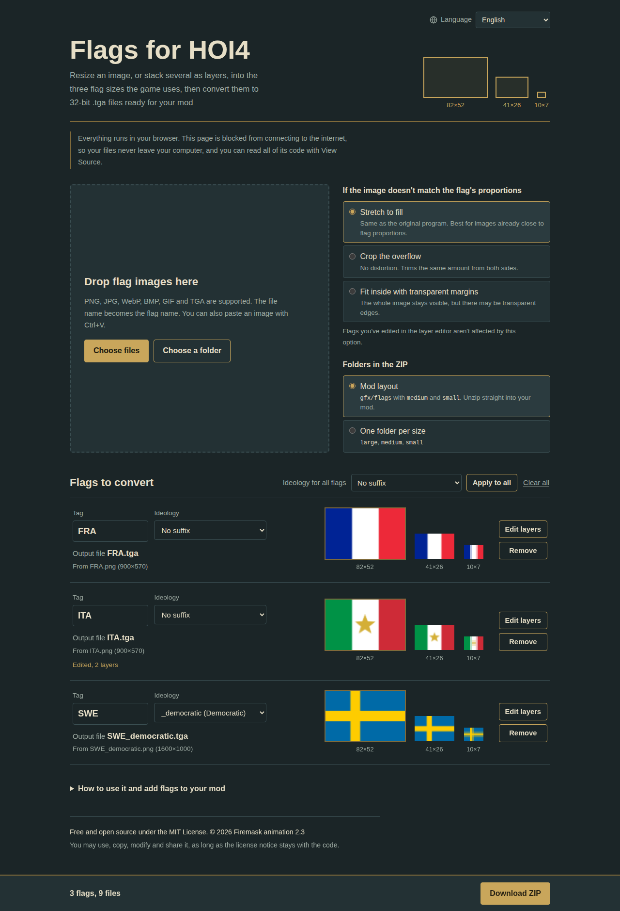
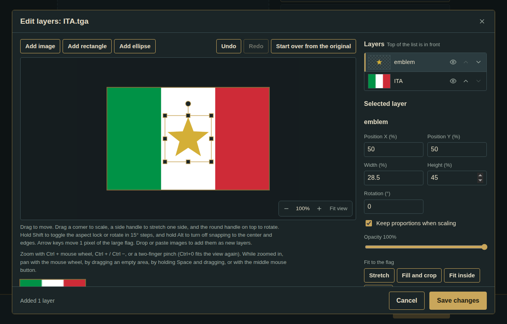

# HOI4 Flag Tool

A free, offline, single-file tool for making **Hearts of Iron IV** flags. Drop in your images, or stack several as layers, and download ready-to-use 32-bit TGA flags in all three sizes the game needs: **82×52**, **41×26** and **10×7**.

No install, no build step, no dependencies. It's one HTML file you open in your browser.

## Features

- **Converts** PNG, JPG, WebP, BMP, GIF and TGA into uncompressed 32-bit TGA with transparency, the format HOI4 expects.
- **Exports a ZIP laid out like a mod**: `gfx/flags`, `gfx/flags/medium` and `gfx/flags/small`. Unzip it straight into your mod folder.
- **Ideology suffixes**: `_communism`, `_democratic`, `_fascism` and `_neutrality` can be picked per flag or for all flags at once, and are detected automatically from file names like `GER_fascism.png`.
- **Duplicate-name check** so flags never overwrite each other in the ZIP.
- **Layer editor**: stack images, rectangles and ellipses; move, scale, stretch, rotate, flip and change opacity; snapping to the center and edges; undo/redo; live previews of all three sizes.
- **Zoom from 10% to 1600%** with Ctrl + mouse wheel, keyboard shortcuts or a two-finger pinch, plus a pixel grid when zoomed in close.
- **8 languages**: English, ไทย, Русский, 简体中文, 日本語, Deutsch, Español and Português (Brasil).
- **Private by design**: everything runs in your browser. A Content-Security-Policy blocks all network access, so your images never leave your computer.

## How to use it

**Online (GitHub Pages)**

1. In this repository, go to **Settings → Pages**.
2. Under **Build and deployment**, choose **Deploy from a branch**, pick the `main` branch and the `/ (root)` folder, then save.
3. After a minute the tool is live at `https://<your-username>.github.io/<repository-name>/`.

**Offline**

Download `index.html` and open it in a modern browser such as Chrome, Edge or Firefox. It works without an internet connection.

**Language**

The tool opens in English. Use the language menu in the top-right corner, or add the language to the link, for example `index.html#lang=th` for Thai.

## Putting the flags in your mod

1. Download the ZIP with the **Mod layout** option.
2. Unzip it and copy the `gfx` folder into your mod folder.
3. The file name must match the country tag, such as `GER.tga`. Ideology flags like `GER_fascism.tga` are used while that ideology is in power; the flag without a suffix is the fallback.

## Adding a language

All text lives in the `I18N` object inside `index.html`.

1. Copy the whole `en: { ... }` block and translate the strings. Keep the `{placeholders}` as they are.
2. Add the language to the `LANGS` list: its code, its own name, and its HTML language tag.
3. Strings written as `{ one: '...', other: '...' }` are plural forms, chosen automatically with the browser's plural rules.

## Technical notes

- Output is 32-bit uncompressed TGA (type 2) with 8 alpha bits and bottom-left origin, the same layout GIMP exports by default.
- Layers are drawn on an 820×520 working canvas (10× the large flag) and scaled down in halving steps for clean small flags.
- The ZIP writer and the TGA reader and writer are written from scratch inside the file, so nothing is loaded from the internet.

## License

[MIT](LICENSE) © 2026 Firemask animation 2.3

You may use, copy, modify and share this tool, including in other projects, as long as the license notice stays with the code. Flags you make with it are entirely yours.

---

## ภาษาไทย

เครื่องมือทำธงสำหรับ **Hearts of Iron IV** แบบไฟล์ HTML ไฟล์เดียว ใช้งานฟรีและทำงานแบบออฟไลน์ ใส่รูป หรือซ้อนหลายรูปเป็นเลเยอร์ แล้วดาวน์โหลดธง .tga 32 บิตครบ 3 ขนาดที่เกมใช้ (82×52, 41×26 และ 10×7) จัดโฟลเดอร์แบบ mod มาให้แล้ว

- **ใช้ออนไลน์:** เปิด GitHub Pages ของ repo นี้ตามขั้นตอนด้านบน
- **ใช้ออฟไลน์:** ดาวน์โหลด `index.html` แล้วเปิดด้วยเบราว์เซอร์
- **เปลี่ยนเป็นภาษาไทย:** เลือกจากเมนูภาษามุมขวาบน หรือเปิดลิงก์ที่ลงท้ายด้วย `#lang=th`

รูปทั้งหมดประมวลผลในเครื่องของคุณ ไม่มีการส่งไฟล์ออกไปไหน เผยแพร่ภายใต้สัญญาอนุญาต [MIT](LICENSE) ใช้ แก้ไข และแจกต่อได้ โดยต้องเก็บข้อความสัญญาอนุญาตไว้กับโค้ด
